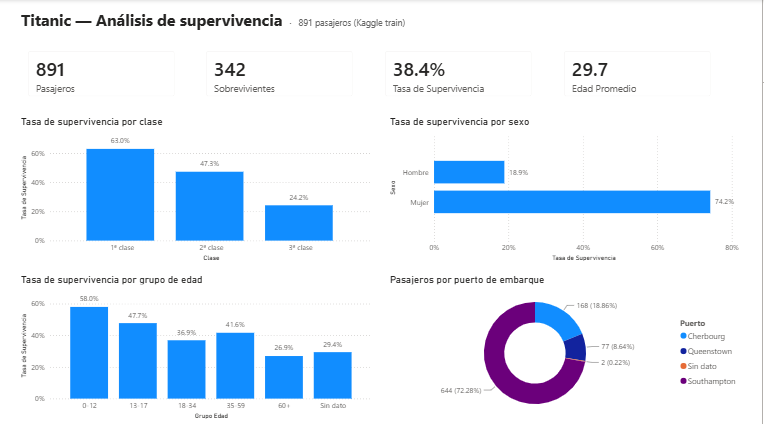

# Titanic — Análisis de supervivencia en Power BI

Dashboard en **Power BI** (formato PBIP con TMDL/PBIR, versionable en Git) sobre el dataset
[Titanic de Kaggle](https://www.kaggle.com/c/titanic): 891 pasajeros de entrenamiento y 418 de prueba.

## Hallazgos
- Sobrevivió el **38.4 %** de los pasajeros (342 de 891).
- **Sexo**: las mujeres sobrevivieron 4 veces más que los hombres (74.2 % vs 18.9 %).
- **Clase**: 63.0 % en 1ª clase frente a 24.2 % en 3ª — la clase socioeconómica fue determinante.
- **Edad**: los niños (0–12) tuvieron la mayor tasa (58.0 %); los mayores de 60, la menor (26.9 %).
- **Embarque**: 72 % subió en Southampton.

## Modelo semántico
| Tipo | Elementos |
|---|---|
| Medidas DAX | `Pasajeros`, `Sobrevivientes`, `Fallecidos`, `Tasa de Supervivencia`, `Edad Promedio`, `Tarifa Promedio` |
| Columnas calculadas | `Estado`, `Clase`, `Sexo`, `Puerto`, `Grupo Edad` (ordenada por `Orden Edad`), `Tamaño Familia` |
| Power Query (M) | Carga CSV con `QuoteStyle.Csv` (los nombres contienen comas) y tipos con cultura `en-US` |

## Abrir el proyecto
1. Clona el repo y abre `PBI_TITANIC.pbip` con Power BI Desktop.
2. Las consultas apuntan a `D:\DSRP_CLAUDE\c.train.csv` / `c.test.csv`. Si clonas en otra ruta,
   actualízala en **Transformar datos → Configuración de origen de datos** y pulsa **Actualizar**.

## Tecnologías
Power BI Desktop · DAX · Power Query (M) · PBIP / TMDL / PBIR

Autor: [Wilder Rojas](https://github.com/ZeReF2609)
